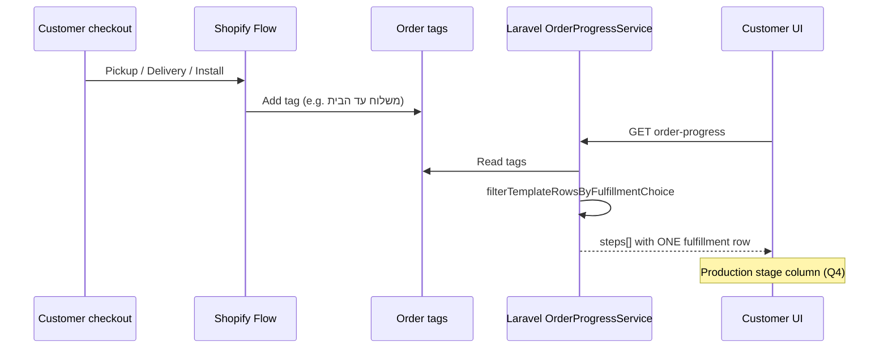

# Client Q&A — Fulfillment Checklist Implementation

This document maps **each client question (Q1–Q4)** to **what to build**, **exact code**, and **deploy steps**.

**Code status in repo:**

| Item | Status |
|------|--------|
| Laravel filter (Q2–Q4) | Done — `OrderProgressService.php` + `config/order-progress.php` |
| Customer Account extension banner (Q2–Q4) | Done — `extensions/.../src/index.jsx` |
| Theme classic checklist (Q4 Production stage) | No code change — uses API `steps[]` already filtered |
| Product metafield JSON (Q2–Q4) | **You must set in Shopify Admin** — example below |
| Shopify Flow tags (Q3) | **Already on client side** — verify tags match config |

---

## Q1 — Tracking URL without fulfilling?

### Client question

> Is there a way to update the tracking URL without fulfilling the order?

### Client answer (what you told them)

> In standard Shopify, the official tracking link is usually connected to fulfill order. If the order is not fulfilled, customers often do not get the normal Shopify tracking email.

### Implementation

| | |
|---|---|
| **App code change?** | **No** |
| **Reason** | Shopify core behavior — tracking email/link is tied to fulfillment |
| **If client needs this later** | Fulfill with tracking only · custom email · tracking app |

**No files to change** for Q1.

---

## Q2 — Only show the delivery option the customer selected

### Client question

> My intention is that in the Order production checklist only the delivery option that the customer selected will be shown.

### Client answer (what you told them)

> You want **one final row per order** (pickup or delivery or delivery + installation), not all three every time. Today the checklist shows all steps on the product. Next step: update so the table shows only the step that matches the order.

### What we build

1. Product metafield still defines **3 fulfillment rows** (pickup, delivery, install).
2. Laravel **filters** those rows before building the API response.
3. Customer sees **one** fulfillment row + all normal production steps.

### Exact code — already in repo

**File:** `app/Services/OrderProgressService.php`

Filter runs in `resolveMergedTemplateRows()`:

```php
$tagsNormalized = $this->normalizeTagsLower((string) Arr::get($order, 'tags', ''));
$templateRows = $this->filterTemplateRowsByFulfillmentChoice($templateRows, $tagsNormalized);
```

Core filter (keeps normal steps; hides non-matching fulfillment rows):

```php
private function filterTemplateRowsByFulfillmentChoice(array $templateRows, array $tagsNormalized): array
{
    if (! (bool) config('order-progress.filter_fulfillment_options_by_flow_tag', true)) {
        return $templateRows;
    }

    $hasConditionalRows = false;
    foreach ($templateRows as $row) {
        if (is_array($row) && $this->isConditionalFulfillmentRow($row)) {
            $hasConditionalRows = true;
            break;
        }
    }

    if (! $hasConditionalRows) {
        return $templateRows;
    }

    $activeChoice = $this->detectFulfillmentChoiceFromOrderTags($tagsNormalized);
    if ($activeChoice === null) {
        return $templateRows; // no Flow tag yet → old behavior (all rows)
    }

    $filtered = [];
    foreach ($templateRows as $row) {
        if (! is_array($row)) {
            continue;
        }
        if (! $this->isConditionalFulfillmentRow($row)) {
            $filtered[] = $row;
            continue;
        }
        if ($this->fulfillmentRowMatchesChoice($row, $activeChoice, $tagsNormalized)) {
            $filtered[] = $row;
        }
    }

    return $filtered;
}
```

**Safe for existing orders:** If no Flow tag on order → **all rows still show** (unchanged).

---

## Q3 — Use Flow tags as the execution option?

### Client question

> Three options (pickup / delivery / delivery + installation), Flow adds tags after each order — is it possible to refer to this tag alone as one of the execution options?

### Client answer (what you told them)

> Yes. Flow and tags are the right approach. We can use only that tag to decide which final step appears in the checklist. The app does not do this automatically yet; it needs a short development update.

### Flow tags (must match exactly)

| Customer choice | Tag Flow adds to order |
|----------------|------------------------|
| Pickup | `אריה שנקר 26` |
| Delivery | `משלוח עד הבית` |
| Delivery + installation | `משלוח + התקנה` |

### Exact code — config mapping

**File:** `config/order-progress.php`

```php
'filter_fulfillment_options_by_flow_tag' => true,

'fulfillment_choice_tags' => [
    'pickup' => 'אריה שנקר 26',
    'delivery' => 'משלוח עד הבית',
    'delivery_installation' => 'משלוח + התקנה',
],
```

### Exact code — detect tag on order

**File:** `app/Services/OrderProgressService.php`

```php
private function detectFulfillmentChoiceFromOrderTags(array $tagsNormalized): ?string
{
    $choices = config('order-progress.fulfillment_choice_tags', []);
    if (! is_array($choices)) {
        return null;
    }

    foreach ($choices as $choiceKey => $flowTag) {
        $tagLower = mb_strtolower(trim((string) $flowTag), 'UTF-8');
        if ($tagLower !== '' && in_array($tagLower, $tagsNormalized, true)) {
            return (string) $choiceKey;
        }
    }

    return null;
}
```

Returns: `pickup` | `delivery` | `delivery_installation` | `null`.

### Link metafield rows to Flow tags

Each fulfillment row in product `production_checklist` JSON needs **`fulfillment_choice`**:

| `fulfillment_choice` | Shown when Flow tag is |
|----------------------|------------------------|
| `pickup` | `אריה שנקר 26` |
| `delivery` | `משלוח עד הבית` |
| `delivery_installation` | `משלוח + התקנה` |

**Alternative:** use `"show_when_order_tag": "משלוח עד הבית"` on the row instead of `fulfillment_choice`.

Parse fields in `parseChecklistJson()` / `configStepsAsTemplates()`:

```php
'fulfillment_choice' => $this->normalizeOptionalString($row['fulfillment_choice'] ?? null),
'show_when_order_tag' => $this->normalizeOptionalString($row['show_when_order_tag'] ?? null),
```

---

## Q4 — Production stage column: only selected shipment option

### Client question

> Put in Production stage — only the option selected in the shipment.

### Client answer (what you told them)

> In the Production stage column, each order should show only the matching option:
> - Tag `אריה שנקר 26` → only pickup-related step
> - Tag `משלוח עד הבית` → only delivery step
> - Tag `משלוח + התקנה` → only delivery + installation step

### How Production stage is rendered

| Surface | File | What it does |
|---------|------|--------------|
| Classic customer account | `aganbarzel-theme/assets/order-progress.js` | Renders `payload.steps[]` from app proxy |
| New customer account | `extensions/.../src/index.jsx` | Renders `payload.steps[]` from API |

**No theme/extension change needed for the table** — both already loop over `steps` from Laravel.  
Q4 is solved by **filtering `steps` in Laravel** (Q2/Q3 code above).

### Ready banner (when all steps done) — extension code

**File:** `extensions/customer-account-order-progress/src/index.jsx`

Uses API `branch` + `fulfillment_message_he` (works with Flow tags via backend):

```javascript
if (payload?.fulfillment_message_he) {
  const branch = payload.branch;
  if (branch === "pickup") {
    return {
      bannerStatus: "success",
      title: "המוצר מוכן לאיסוף",
      message: payload.fulfillment_message_he,
      badgeTone: "success",
      badgeLabel: "מוכן",
    };
  }
  if (branch === "delivery_installation") {
    return {
      bannerStatus: "success",
      title: "המוצר מוכן למשלוח והתקנה",
      message: payload.fulfillment_message_he,
      badgeTone: "success",
      badgeLabel: "מוכן",
    };
  }
  if (branch === "delivery") {
    return {
      bannerStatus: "success",
      title: "המוצר מוכן למשלוח",
      message: payload.fulfillment_message_he,
      badgeTone: "success",
      badgeLabel: "מוכן",
    };
  }
}
```

### Backend branch + message for all 3 options

**File:** `config/order-progress.php`

```php
'fulfillment_message_delivery_installation_he' => 'ההזמנה מוכנה למשלוח והתקנה. תקבלו עדכון כשהמשלוח ייצא.',
```

**File:** `app/Services/OrderProgressService.php` — `buildFromOrderArray()`:

```php
$branch = $this->resolveBranchFromOrderTags($tagsNormalized);

// when all steps done:
} elseif ($branch === 'delivery_installation') {
    $msg = trim((string) config('order-progress.fulfillment_message_delivery_installation_he', ''));
    $fulfillmentMessageHe = $msg !== '' ? $msg : null;
}
```

`resolveBranchFromOrderTags()` checks **Flow tags first**, then legacy `fulfillment-pickup` / `fulfillment-delivery`.

---

## Admin setup — required for Q2–Q4 to work

**Shopify Admin → Products → Metafield `custom.production_checklist`**

Copy this pattern onto products that have 3 shipment options:

```json
[
  {
    "key": "order_received",
    "label_he": "ההזמנה התקבלה",
    "tag": "stage-order-received",
    "position": 0,
    "eta_days": 0,
    "auto_from_order": true
  },
  {
    "key": "suppliers_ordered",
    "label_he": "הוזמנו חלקים אצל הספקים",
    "tag": "stage-suppliers-ordered",
    "position": 1,
    "eta_days": 3
  },
  {
    "key": "product_ready",
    "label_he": "המוצר מוכן",
    "tag": "stage-product-ready",
    "position": 2,
    "eta_days": 1
  },
  {
    "key": "fulfillment_pickup",
    "label_he": "איסוף עצמי — אריה שנקר 26",
    "tag": "stage-fulfillment-pickup",
    "position": 10,
    "eta_days": 0,
    "fulfillment_choice": "pickup",
    "estimate_note": "איסוף מהחנות"
  },
  {
    "key": "fulfillment_delivery",
    "label_he": "משלוח עד הבית",
    "tag": "stage-fulfillment-delivery",
    "position": 11,
    "eta_days": 1,
    "fulfillment_choice": "delivery",
    "estimate_note": "משלוח לכתובת הלקוח"
  },
  {
    "key": "fulfillment_delivery_install",
    "label_he": "משלוח והתקנה",
    "tag": "stage-fulfillment-delivery-install",
    "position": 12,
    "eta_days": 2,
    "fulfillment_choice": "delivery_installation",
    "estimate_note": "משלוח והתקנה בבית הלקוח"
  }
]
```

**Important:** Staff mark the step **done** with the row’s **`tag`** (e.g. `stage-fulfillment-delivery`), not the Flow tag.

---

## Full file list — all client needs

| Q | File | Purpose |
|---|------|---------|
| Q1 | — | No code |
| Q2–Q4 | `config/order-progress.php` | Flow tag map + messages + feature flag |
| Q2–Q4 | `app/Services/OrderProgressService.php` | Filter, parse, branch, webhook uses same filter |
| Q4 | `extensions/customer-account-order-progress/src/index.jsx` | Ready banner for 3 branches |
| Q4 | `aganbarzel-theme/assets/order-progress.js` | **No change** — already renders filtered `steps` |
| Q2–Q4 | Shopify Admin metafield | `fulfillment_choice` on 3 final rows |
| Q3 | Shopify Flow | Adds one tag per order after checkout |

### Supporting methods (full list in `OrderProgressService.php`)

| Method | Role |
|--------|------|
| `normalizeOptionalString()` | Trim optional metafield fields |
| `detectFulfillmentChoiceFromOrderTags()` | Q3 — read Flow tag |
| `isConditionalFulfillmentRow()` | Row has `fulfillment_choice` or `show_when_order_tag` |
| `filterTemplateRowsByFulfillmentChoice()` | Q2 — hide non-matching rows |
| `fulfillmentRowMatchesChoice()` | Match row to active choice |
| `resolveBranchFromOrderTags()` | Q4 banner + `branch` in API |

---

## What does NOT break

| Existing feature | Why safe |
|------------------|----------|
| Normal production steps | No `fulfillment_choice` → always shown |
| Orders without Flow tag | Filter skipped → all rows shown |
| Products without conditional rows | Filter skipped |
| Payment blocking | Unchanged |
| `production_update` note | Unchanged |
| Auto-first step | Unchanged |
| Legacy `fulfillment-pickup` / `fulfillment-delivery` | Still used for banner if no Flow tag |
| RF calculator | Not touched |
| Webhook | Same logic, filtered template list |

**Rollback:** set `'filter_fulfillment_options_by_flow_tag' => false` in config.

---

## Deploy checklist

### Code (Laravel)

- [ ] Deploy `config/order-progress.php`
- [ ] Deploy `app/Services/OrderProgressService.php`

### Code (extension — optional redeploy if using new customer accounts)

```bash
cd C:\Users\adx\Documents\GitHub\Aganbarzeln
shopify app build
shopify app deploy
```

### Admin (required)

- [ ] Add `fulfillment_choice` to last 3 rows in `production_checklist` on products
- [ ] Confirm Flow adds exactly one tag: `אריה שנקר 26` | `משלוח עד הבית` | `משלוח + התקנה`

### Test (Q2–Q4)

| Order tag | Production stage shows |
|-----------|------------------------|
| (none) | All fulfillment rows (until Flow runs) |
| `משלוח עד הבית` | Production steps + **delivery row only** |
| `אריה שנקר 26` | Production steps + **pickup row only** |
| `משלוח + התקנה` | Production steps + **install row only** |

Test on:

- Classic: `/account/orders/{id}`
- New accounts: order status extension block

---

## Flow diagram (Q2 + Q3 + Q4)



---

## Q&A quick reference

| Q | Client wants | Code? | Where |
|---|--------------|-------|-------|
| **Q1** | Tracking without fulfill | No | Shopify limitation |
| **Q2** | One fulfillment row per order | Yes | `filterTemplateRowsByFulfillmentChoice` |
| **Q3** | Use Flow tags | Yes | `fulfillment_choice_tags` + detect method |
| **Q4** | Production stage shows only match | Yes | Filtered `steps[]` + metafield `fulfillment_choice` |
