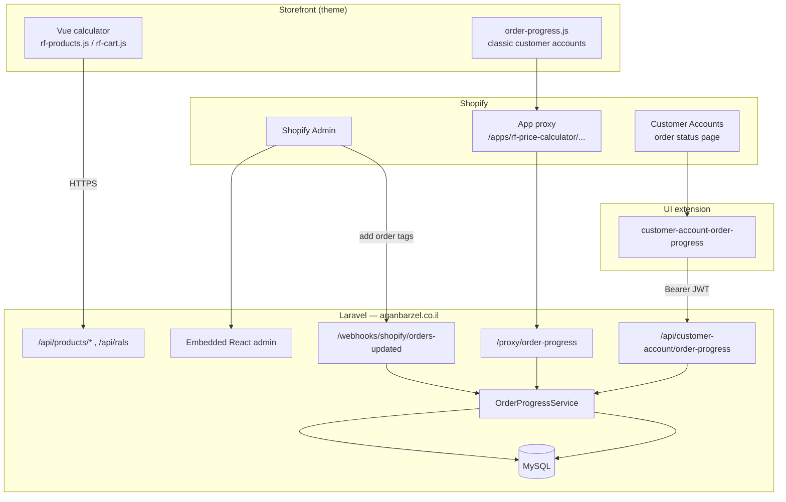
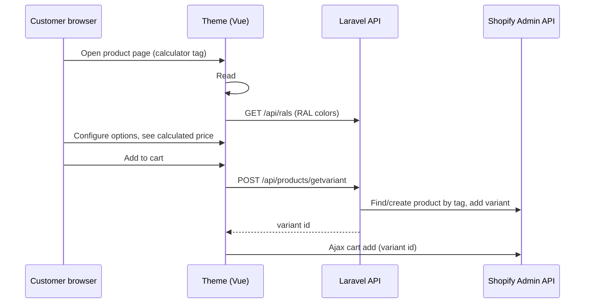

# Agan Barzel — Full Project Overview

This document describes how the **אגן ברזל (Agan Barzel)** Shopify stack works end to end: the private app, the storefront theme, Partner Dashboard configuration, data flows, deployment, and where to change things.

**Last reviewed:** June 2026  
**Audience:** Developers working on calculator, order progress, admin, or theme changes.

---

## Table of contents

1. [What this system is](#1-what-this-system-is)
2. [Repositories and locations](#2-repositories-and-locations)
3. [High-level architecture](#3-high-level-architecture)
4. [Shopify Partner app configuration](#4-shopify-partner-app-configuration)
5. [Laravel private app (`Aganbarzeln`)](#5-laravel-private-app-aganbarzeln)
6. [Feature A — RF price calculator](#6-feature-a--rf-price-calculator)
7. [Feature B — Order production progress](#7-feature-b--order-production-progress)
8. [Storefront theme (`aganbarzel-theme`)](#8-storefront-theme-aganbarzel-theme)
9. [Database schema](#9-database-schema)
10. [API and route reference](#10-api-and-route-reference)
11. [Authentication and security](#11-authentication-and-security)
12. [Deployment guide](#12-deployment-guide)
13. [Development workflows](#13-development-workflows)
14. [Where to change what](#14-where-to-change-what)
15. [Known issues and technical debt](#15-known-issues-and-technical-debt)
16. [Related documentation](#16-related-documentation)

---

## 1. What this system is

Agan Barzel is a Hebrew RTL Shopify store (metalwork / mirrors / custom furniture). The technical stack combines:

| Piece | Role |
|-------|------|
| **Shopify store** | Catalog, checkout, orders, customer accounts |
| **Wokiee theme (customized)** | Storefront UI, product calculator UI, order progress widget |
| **Laravel app `rf-price-calculator`** | Backend API, embedded admin, webhooks, app proxy |
| **Customer Account UI extension** | Order progress on new Shopify Customer Accounts |

The app serves **two independent features** that share the same Partner app credentials:

1. **RF price calculator** — Customers configure custom products on the storefront; Laravel creates Shopify variants with calculated prices on the fly.
2. **Order production progress** — Customers see a Hebrew production checklist on their order; staff drive progress by adding tags in Shopify Admin.

---

## 2. Repositories and locations

| Path | What it is |
|------|------------|
| `C:\Users\adx\Documents\GitHub\Aganbarzeln` | Laravel Shopify app + extension source |
| `C:\Users\adx\Desktop\aganbarzel-theme` | Live Shopify theme (pulled from theme `#185503744289`) |

### Store identifiers

| Key | Value |
|-----|-------|
| Public site | `https://aganbarzel.co.il` |
| myshopify domain | `xn-vldfbc4as7alqs6ghx.myshopify.com` |
| Active theme | `wokiee - rftech 03-01-2025` (`#185503744289`) |
| Theme base | Wokiee 2.3.4 (Shopify 2.0) |

### Production vs staging

| Environment | Laravel URL |
|-------------|-------------|
| Production | `https://aganbarzel.co.il` |
| Staging | `https://staging.aganbarzel.co.il` |

Both are registered as OAuth redirect URLs in Partner Dashboard and `shopify.app.toml`.

---

## 3. High-level architecture



**Data ownership:**

- **Product catalog & orders** — Shopify (source of truth)
- **Calculator variant buckets** — Shopify products tagged per admin-defined slug
- **RAL paint catalog** — Laravel `rals` table
- **Tag slugs for calculator cleanup** — Laravel `tags` table
- **Step completion timestamps** — Laravel `order_progress_step_completions` table (first-write-wins when staff add tags)

---

## 4. Shopify Partner app configuration

**App name:** `rf-price-calculator`  
**Current version (example):** `rf-price-calculator-18`  
**Client ID:** `5ce265f0cd011b8612dffb530a54ce01` (same as `SHOPIFY_API_KEY`)

### Version page settings (Partner Dev Dashboard)

| Setting | Value |
|---------|-------|
| App URL | `https://aganbarzel.co.il` |
| Embedded | `true` |
| Redirect URLs | `aganbarzel.co.il` + `staging.aganbarzel.co.il` authenticate/callback |
| Scopes | `read_products`, `write_products`, `read_orders`, `write_orders`, `read_shipping`, `write_shipping`, `write_customers`, `write_draft_orders` |
| Webhook | `orders/updated` → `https://aganbarzel.co.il/webhooks/shopify/orders-updated` |
| UI extension | `customer-account-order-progress` |

### App proxy (configure in Partner → App → Settings, not on Versions page)

| Field | Value |
|-------|-------|
| Subpath prefix | `rf-price-calculator` |
| Proxy URL | `https://aganbarzel.co.il/proxy/order-progress` |

The subpath **must match** `snippets/order-progress.liquid` and `shopify.app.toml` `name`.

### Local CLI manifest

`shopify.app.toml` at the Laravel repo root mirrors Partner config and enables `shopify app deploy` for the Customer Account extension.

---

## 5. Laravel private app (`Aganbarzeln`)

### Tech stack

| Layer | Technology |
|-------|------------|
| Backend | PHP 7.3+/8.x, Laravel 8 |
| Shopify integration | `osiset/laravel-shopify` ^17.1 |
| Admin UI | React 19, Polaris 13, App Bridge |
| Build | Laravel Mix / Webpack |
| Extension | `@shopify/ui-extensions-react` (Customer Accounts) |

### Directory map

```
Aganbarzeln/
├── app/
│   ├── Http/Controllers/
│   │   ├── ProductController.php      # Calculator API + admin product cleanup
│   │   ├── TagController.php          # Tag CRUD
│   │   ├── RalController.php          # RAL color CRUD + public API
│   │   ├── Storefront/
│   │   │   ├── AppProxyOrderProgressController.php
│   │   │   └── CustomerAccountOrderProgressController.php
│   │   └── Webhooks/ShopifyOrdersUpdatedController.php
│   ├── Services/OrderProgressService.php   # Shared checklist logic
│   ├── Support/
│   │   ├── ShopifyAppProxy.php        # HMAC verification
│   │   ├── ShopifyWebhookVerifier.php
│   │   └── ShopifySessionToken.php    # JWT for Customer Accounts
│   ├── Models/                        # User (shop), Tag, Ral, OrderProgressStepCompletion
│   ├── Jobs/DeleteProducts.php        # Scheduled variant cleanup
│   └── helpers.php                    # delete_products, delete_unused_variants
├── config/
│   ├── shopify-app.php
│   └── order-progress.php             # Hebrew steps, tags, metafield keys
├── routes/web.php, api.php
├── resources/js/                      # Embedded admin React app
├── extensions/customer-account-order-progress/
├── theme-assets-anagn/                # Backup copy of order-progress.css
├── docs/
└── shopify.app.toml
```

### Shop model

Each installed store is a row in `users` (Laravel default + osiset columns):

- `users.name` = shop domain, e.g. `xn-vldfbc4as7alqs6ghx.myshopify.com`
- OAuth access token stored by osiset package
- Calculator API looks up shop by `request->shop` matching `users.name`

### Embedded admin UI

Opened from **Shopify Admin → Apps → rf-price-calculator**.

| Route (client) | Page | Purpose |
|----------------|------|---------|
| `/` | Home (`ProductsCard`) | Per-tag product/variant counts; schedule or run bulk delete |
| `/tags` | Tags | Create/delete tag slugs used as Shopify product tags |
| `/rals` | RAL Colors | Manage paint color catalog |

Built with App Bridge `authenticatedFetch` for session token refresh. Entry: `resources/js/app.js` → `public/js/app.js`.

### Scheduled job

`app/Console/Kernel.php` runs `DeleteProducts` every **5 minutes**.

Current behavior: deletes unused calculator variants for a hardcoded dev shop (`rftechnologies-teams.myshopify.com`). Tag-based scheduled deletion code is commented out.

---

## 6. Feature A — RF price calculator

### Purpose

Sell made-to-measure products (mirrors, shelves, frames, etc.). Price depends on customer-selected dimensions and options. Each configuration becomes a **unique Shopify variant** created at add-to-cart time.

### End-to-end flow



### Theme side

1. **Product tag** determines which calculator config loads (e.g. `calculator-01`, `book-shelf`, `mirror-products`).
2. **`sections/product-template.liquid`** outputs a `<script id="calculator-data">` JSON block per tag (~38 configurations). Each config includes:
   - `options` — `range`, `radio`, `note`, `price` fields with Hebrew labels and **formula** strings
   - `productInfo` — title, image, weight, SKU, shipping profile name
   - `tag` — Shopify product tag used to bucket variants
   - `credentials` — shop domain (and historically an Admin API token — see security section)
3. **`snippets/product_page_1_description.liquid`** — block type `calculator` renders `<div id="app"></div>` when product has a calculator tag; hides default add-to-cart form.
4. **`layout/theme.liquid`** loads on product/cart pages:
   - `chunk-vendors.js`, `chunk-common.js` (Vue 3 webpack: `webpackChunkprice_calculator`)
   - `rf-products.js` + `rf-products.css` (product page)
   - `rf-cart.js` + `rf-cart.css` (cart page, defer)

### Laravel API side (`ProductController`)

**`POST /api/products/getvariant`** (main endpoint):

1. Receives: `shop`, `title`, `price`, `tag`, `image`, `weight`, `weight_unit`, `sku`, `requires_shipping`, `shipping_profile`
2. Looks up shop: `User::where('name', $request->shop)`
3. Finds latest Shopify product with that `tag` (GraphQL)
4. If none exists → creates product titled **"אגן ברזל"** with the tag
5. If product has **&lt; 90 variants** → adds variant to existing product; else creates new product container
6. Variant title appended with timestamp: `{title} - {H:i:s_d/m/Y}` (Israel offset +3h)
7. Optionally assigns variant to a **delivery profile** via GraphQL `deliveryProfileUpdate`
8. Returns variant data as JSON

**`POST /api/products/updatevariant`** — updates variant title/price (cart re-edit flow).

**`GET /api/rals`** — returns all rows from `rals` table for RAL color pricing in calculator.

**`POST /api/products/create`** — legacy/simple product create endpoint.

### Cart re-edit flow

1. Calculator line items store custom **line item properties** (including a `product` key with config handle).
2. `snippets/cartpage-design1.liquid` shows **"ערוך"** (edit) button when property exists.
3. `snippets/edit-modal.liquid` provides popup mount `#edit`.
4. `rf-cart.js` reloads product JSON and remounts calculator with `variantId`, `lineId`, `defaultPrice`.

### Admin tag management

- Staff create **tag slugs** in app admin (e.g. `Profile-shelf`).
- These slugs are used as Shopify **product tags** when creating variant container products.
- Home page shows product/variant counts per tag.
- Staff can delete all products for a tag or set a `delete_date` for scheduled cleanup (job partially implemented).

### Calculator source code note

The **Vue/webpack source** for `rf-products.js` / `chunk-common.js` is **not** in either repo — only compiled bundles live in theme `assets/`. Bundles call:

- `https://aganbarzel.co.il/api/rals`
- `https://aganbarzel.co.il/api/products/getvariant`
- `https://aganbarzel.co.il/api/products/updatevariant`

To change calculator **UI logic**, you need the original `price_calculator` webpack project or edit minified bundles (not recommended).

---

## 7. Feature B — Order production progress

### Purpose

Customers track **production stages** for custom orders. Staff mark progress by adding **tags** to orders in Shopify Admin. Customers see a Hebrew checklist with status, completion dates, ETA, and payment/fulfillment messages.

### Checklist definition (priority order)

1. **Per-product metafield** `custom.production_checklist` (JSON array) — merged across all products in the order; first occurrence of each `key` wins.
2. **Fallback:** `config/order-progress.php` default steps if no metafield.

Example default steps (config):

| Key | Hebrew label | Order tag | ETA days |
|-----|--------------|-----------|----------|
| `suppliers_ordered` | הוזמנו חלקים אצל הספקים | `stage-suppliers-ordered` | 3 |
| `aluminum_received` | התקבל אלומיניום מהלייזר | `stage-aluminum-received` | 2 |
| `mirror_received` | התקבלה הזכוכית | `stage-mirror-received` | 2 |
| `frame_sent_paint` | המסגרת נשלחה לצביעה | `stage-frame-paint-sent` | 3 |
| `frame_back_paint` | המסגרת חזרה מהצביעה | `stage-frame-paint-back` | 2 |
| `product_ready` | המוצר מוכן | `stage-product-ready` | 1 |

### Staff workflow

1. Add stage tag to order in Shopify Admin (e.g. `stage-mirror-received`).
2. Optionally set order metafield `custom.production_update` for a manual delay note (shown to customer).
3. Optionally set product metafield `custom.production_checklist` for product-specific steps.
4. Add `fulfillment-pickup` or `fulfillment-delivery` when order is ready for customer.

### Backend logic (`OrderProgressService`)

**`build($shop, $orderId, $customerId)`:**

1. Fetches order via Shopify Admin REST API
2. Verifies `customer.id` matches logged-in customer (403 if not)
3. Resolves checklist template (metafield merge → config fallback)
4. Marks step **done** when its `tag` appears on order (case-insensitive)
5. **Auto-completes first step** from `order.created_at` (config: `auto_complete_first_step`)
6. Merges `completed_at` from DB (`order_progress_step_completions`)
7. Computes `step_state`: `done` | `in_progress` | `pending`
8. Blocks ETA if payment status is `pending`, `partially_paid`, or `authorized`
9. Returns JSON payload (see below)

**`recordStepCompletionsFromWebhook($shop, $orderPayload)`:**

- Called on `orders/updated` webhook
- For each checklist step whose tag is on the order, `firstOrCreate` a completion row with UTC `completed_at`
- First-write-wins: does not overwrite existing completion timestamps

### Customer surfaces

#### A. Classic customer accounts (theme)

| File | Role |
|------|------|
| `templates/customers/order.liquid` | `` |
| `snippets/order-progress.liquid` | Mount `#order-progress-root`, sets `data-proxy-base` |
| `assets/order-progress.js` | Fetches proxy URL, renders Hebrew table |
| `assets/order-progress.css` | Styles |

**Request:**

```
GET {shop.url}/apps/rf-price-calculator/order-progress?order_id={id}&shop=...&signature=...&logged_in_customer_id=...
```

Shopify forwards to Laravel `/proxy/order-progress` with HMAC query params.

**Auth:** `ShopifyAppProxy::isValid()` — HMAC-SHA256 with API secret; 5-minute timestamp skew limit.

#### B. New Customer Accounts (UI extension)

| File | Role |
|------|------|
| `extensions/customer-account-order-progress/src/index.jsx` | React block on order status page |
| `extensions/customer-account-order-progress/shopify.extension.toml` | Extension manifest |

**Request:**

```
GET https://aganbarzel.co.il/api/customer-account/order-progress?order_id={id or GID}
Authorization: Bearer {shopify_session_token}
```

**Auth:** `ShopifySessionToken::decodeAndVerify()` — JWT from Customer Account session.

`API_BASE_URL` is hardcoded in `index.jsx` as `https://aganbarzel.co.il` — update before deploy if using staging.

### API response shape (both surfaces)

```json
{
  "order_name": "#1234",
  "financial_status": "paid",
  "fulfillment_status": null,
  "cancelled_at": null,
  "branch": "delivery",
  "is_payment_blocked": false,
  "payment_message_he": null,
  "steps": [
    {
      "key": "suppliers_ordered",
      "label_he": "הוזמנו חלקים אצל הספקים",
      "step_state": "done",
      "completed_at": "2026-06-01T10:00:00+00:00",
      "eta_days": 3,
      "estimate_display": "...",
      "notes_display": "..."
    }
  ],
  "eta_summary_he": "נותרו כ-5 ימי עבודה משוערים",
  "fulfillment_message_he": null,
  "production_update_note": "עיכוב בגלל ספק",
  "order_tags": ["stage-mirror-received", "fulfillment-delivery"],
  "checklist_source": "product_metafield"
}
```

---

## 8. Storefront theme (`aganbarzel-theme`)

### Theme structure

| Folder | Contents |
|--------|----------|
| `layout/` | `theme.liquid` (main), password, gift card |
| `sections/` | ~80 sections; **`product-template.liquid`** is the largest custom file |
| `snippets/` | ~122 snippets; calculator + order progress integration |
| `templates/` | JSON templates (Shopify 2.0) + legacy `.liquid` customer templates |
| `assets/` | Wokiee core + RF calculator bundles + order-progress assets |
| `config/` | `settings_schema.json`, `settings_data.json` |
| `locales/` | `he.json` primary language |

### RTL / Hebrew

- `settings_data.json`: `use_rtl: true` → `rtlstyle` class, loads `style-rtl.css`
- Font: **Heebo**
- Calculator, tabs, FAQ, cart edit button use Hebrew copy and RTL layout
- WhatsApp float with Hebrew default message

### Theme files tied to Laravel app

| Theme file | App connection |
|------------|----------------|
| `sections/product-template.liquid` | Calculator JSON configs per product tag |
| `snippets/product_page_1_description.liquid` | `#app` mount, calculator tag gate |
| `layout/theme.liquid` | Loads RF JS/CSS on product + cart |
| `assets/rf-products.js`, `rf-cart.js`, `chunk-*.js` | Vue calculator (compiled) |
| `snippets/order-progress.liquid` | App proxy URL |
| `assets/order-progress.js`, `.css` | Classic order progress UI |
| `templates/customers/order.liquid` | Renders order progress |
| `snippets/cartpage-design1.liquid`, `edit-modal.liquid` | Cart calculator re-edit |

### Theme files NOT from Laravel

| Integration | Notes |
|-------------|-------|
| **Loox Reviews** | App block on product/index |
| **Bloy Loyalty** | Popup widget; RTL overrides in `theme.liquid` |
| **Instafeed** | Home page |
| **Wokiee ThemePlus** | Metafield editor; external wishlist/compare API via `shop.metafields.ollistsapp` |

### Theme deploy commands

```powershell
cd C:\Users\adx\Desktop\aganbarzel-theme

# Pull latest from Shopify
shopify theme pull --store xn-vldfbc4as7alqs6ghx --theme 185503744289

# Push local changes (use duplicate theme for testing first)
shopify theme push --store xn-vldfbc4as7alqs6ghx --theme 185503744289
```

---

## 9. Database schema

### `users` (Shopify shop)

Managed by Laravel + osiset. Key field: `name` = `*.myshopify.com`.

### `tags`

| Column | Type | Purpose |
|--------|------|---------|
| `id` | bigint | PK |
| `name` | string | Unique slug; used as Shopify product tag |
| `shop_id` | bigint | Owning shop (added after initial migration) |
| `delete_date` | datetime nullable | Scheduled bulk delete date |

### `rals`

| Column | Type | Purpose |
|--------|------|---------|
| `id` | bigint | PK |
| `name` | string | Display name (e.g. RAL 6000) |
| `code` | string | Color code |
| `price` | string | Price in ₪ |
| `time` | string nullable | Lead time text |

### `order_progress_step_completions`

| Column | Type | Purpose |
|--------|------|---------|
| `id` | bigint | PK |
| `user_id` | FK → users | Shop |
| `shopify_order_id` | bigint | Numeric Shopify order ID |
| `step_key` | string | Checklist key from metafield/config |
| `completed_at` | timestampTz | First-seen completion (UTC) |

Unique: `(user_id, shopify_order_id, step_key)`.

---

## 10. API and route reference

### Public storefront API (`/api/*`) — no auth

| Method | Path | Controller | Purpose |
|--------|------|------------|---------|
| POST | `/api/products/getvariant` | ProductController@getVariant | Create/find variant for calculator |
| POST | `/api/products/updatevariant` | ProductController@updateVariant | Update variant on cart edit |
| POST | `/api/products/create` | ProductController@create | Legacy product create |
| GET | `/api/rals` | RalController@getAll | RAL color list |
| GET | `/api/testing` | closure | Health check |
| GET | `/api/customer-account/order-progress` | CustomerAccountOrderProgressController@show | Extension endpoint (Bearer JWT) |

### Web routes (`/`)

| Method | Path | Auth | Purpose |
|--------|------|------|---------|
| GET | `/` | verify.shopify | Embedded admin shell |
| GET | `/products/count`, `/delete`, `/getProducts` | verify.shopify | Admin product management |
| GET/POST | `/tags/*` | mixed | Tag CRUD (some routes lack auth) |
| GET/POST | `/rals/*` | mixed | RAL CRUD (some routes lack auth) |
| GET | `/proxy/order-progress` | HMAC proxy | Classic order progress |
| POST | `/webhooks/shopify/orders-updated` | HMAC webhook | Record step completions |

### Shopify metafields used

| Owner | Namespace.key | Purpose |
|-------|---------------|---------|
| Product | `custom.production_checklist` | Per-product checklist JSON |
| Order | `custom.production_update` | Manual production delay note |
| Product | `custom.*` (theme) | `production`, `delivery_time`, `material`, FAQ, etc. |

---

## 11. Authentication and security

| Surface | Mechanism |
|---------|-----------|
| Embedded admin | Shopify OAuth + `verify.shopify` middleware + App Bridge session token |
| App proxy | HMAC query signature (`ShopifyAppProxy`) + `logged_in_customer_id` |
| Customer Account extension | Bearer JWT (`ShopifySessionToken`) |
| Webhooks | `X-Shopify-Hmac-Sha256` (`ShopifyWebhookVerifier`) |
| Calculator API | **No authentication** — relies on `shop` domain in request body |

### Security concerns

1. **Admin API token in theme HTML** — `product-template.liquid` embeds `shpat_...` in calculator JSON `credentials` blocks visible in page source. Should be removed; variant creation should go only through Laravel API.
2. **Unauthenticated `/api/products/*`** — any caller who knows the endpoint and shop domain can create variants.
3. **Some admin routes lack `verify.shopify`** — e.g. `GET /tags`, `POST /tags/updateDate`, `POST /rals/delete`.
4. **Hardcoded URLs** — extension `API_BASE_URL`, calculator bundles point to production `aganbarzel.co.il`.

---

## 12. Deployment guide

### Laravel app

1. Deploy PHP code to server (`aganbarzel.co.il` or staging).
2. Set `.env` from `.env.example` (Shopify keys, DB, `APP_URL`).
3. Run `php artisan migrate`.
4. Ensure cron runs `php artisan schedule:run` (for `DeleteProducts` job).
5. Install app on shop if not already (OAuth flow).

### Customer Account extension

From `Aganbarzeln` root:

```bash
shopify app build
shopify app deploy
```

Update `API_BASE_URL` in `extensions/customer-account-order-progress/src/index.jsx` if needed before build.

Enable block in **Shopify Admin → Settings → Customer accounts → Customize**.

### Theme

```powershell
cd C:\Users\adx\Desktop\aganbarzel-theme
shopify theme push --store xn-vldfbc4as7alqs6ghx --theme {THEME_ID}
```

**Best practice:** Duplicate live theme in Admin, push to duplicate, preview, then publish.

### Order progress CSS sync

Canonical theme copy: `assets/order-progress.css`  
Backup in Laravel repo: `theme-assets-anagn/order-progress.css` — keep in sync when changing styles.

---

## 13. Development workflows

### Pull theme before editing

```powershell
cd C:\Users\adx\Desktop\aganbarzel-theme
shopify theme pull --store xn-vldfbc4as7alqs6ghx --theme 185503744289
```

### Local Laravel

```bash
cp .env.example .env
php artisan key:generate
# configure DB + Shopify keys
php artisan serve
```

Use ngrok or staging URL for OAuth during local dev.

### Build admin React

```bash
npm install
npm run dev    # or npm run production
```

### Test order progress

1. Create test order with calculator product.
2. Add stage tags in Shopify Admin.
3. View as customer on `/account/orders/{id}` (classic) or Customer Accounts order status (extension).
4. Verify webhook fired: check Laravel logs / `order_progress_step_completions` table.

### Add new calculator product type

1. Create product in Shopify with unique **tag** (e.g. `new-product-type`).
2. Add matching `` block in `product-template.liquid` with full JSON config.
3. Add tag to the list in `product_page_1_description.liquid` calculator block condition.
4. Ensure `product.json` (or template) includes block type `calculator`.
5. Optionally create matching tag slug in app admin if using a new variant bucket tag.
6. Push theme; test add-to-cart → verify variant created in Admin.

---

## 14. Where to change what

| Goal | Location |
|------|----------|
| Default production steps | `config/order-progress.php` |
| Product-specific checklist | Shopify Admin → product metafield `custom.production_checklist` |
| Order delay note | Shopify Admin → order metafield `custom.production_update` |
| Checklist business logic | `app/Services/OrderProgressService.php` |
| Classic order progress UI | `aganbarzel-theme/assets/order-progress.js` + `.css` |
| New accounts order progress UI | `extensions/.../src/index.jsx` |
| Variant creation rules | `app/Http/Controllers/ProductController.php` |
| RAL colors | App admin or `rals` table |
| Calculator product configs | `aganbarzel-theme/sections/product-template.liquid` |
| Calculator UI (Vue) | Original `price_calculator` webpack project → rebuild → copy to theme `assets/` |
| Admin dashboard | `resources/js/` |
| App proxy / webhook handlers | `app/Http/Controllers/Storefront/`, `Webhooks/` |
| Partner app settings | Dev Dashboard + `shopify.app.toml` |

---

## 15. Known issues and technical debt

| Issue | Detail |
|-------|--------|
| Calculator source not in repo | Only minified bundles in theme; UI changes need separate webpack project |
| Exposed Admin token in theme | `credentials.token` in `product-template.liquid` |
| Unauthenticated calculator API | No rate limiting or shop secret on `/api/products/*` |
| DeleteProducts job | Hardcoded shop domain; tag scheduled delete commented out |
| Scope mismatch | `.env.example` scopes narrower than `shopify.app.toml` |
| Mixed route auth | Some tag/RAL routes accessible without `verify.shopify` |
| `product-calculator.liquid` | Appears unused (legacy mockup) |
| Extension API URL | Hardcoded production URL in `index.jsx` |

---

## 16. Related documentation

| Document | Path | Focus |
|----------|------|-------|
| Order progress development guide | `docs/ORDER_PROGRESS_DEVELOPMENT_GUIDE.md` | Feature deep dive, testing, Partner setup |
| Order progress rebuild guide | `docs/ORDER_PROGRESS_DEVELOPER_REBUILD_GUIDE.md` | Step-by-step rebuild from scratch |
| Extension README | `extensions/customer-account-order-progress/README.md` | Deploy checklist for UI extension |
| This overview | `docs/PROJECT_OVERVIEW.md` | Full system map |

---

## Quick reference — alignment checklist

These values **must stay in sync** across Partner Dashboard, Laravel, and theme:

| Concept | Value |
|---------|-------|
| App name / proxy subpath | `rf-price-calculator` |
| Laravel app URL | `https://aganbarzel.co.il` |
| App proxy backend | `https://aganbarzel.co.il/proxy/order-progress` |
| Webhook | `https://aganbarzel.co.il/webhooks/shopify/orders-updated` |
| Theme proxy fetch | `{shop.url}/apps/rf-price-calculator/order-progress` |
| Calculator API base | `https://aganbarzel.co.il/api/` |
| Shop myshopify domain | `xn-vldfbc4as7alqs6ghx.myshopify.com` |

If any of these drift, calculator add-to-cart or order progress will break silently or return 401/404.
